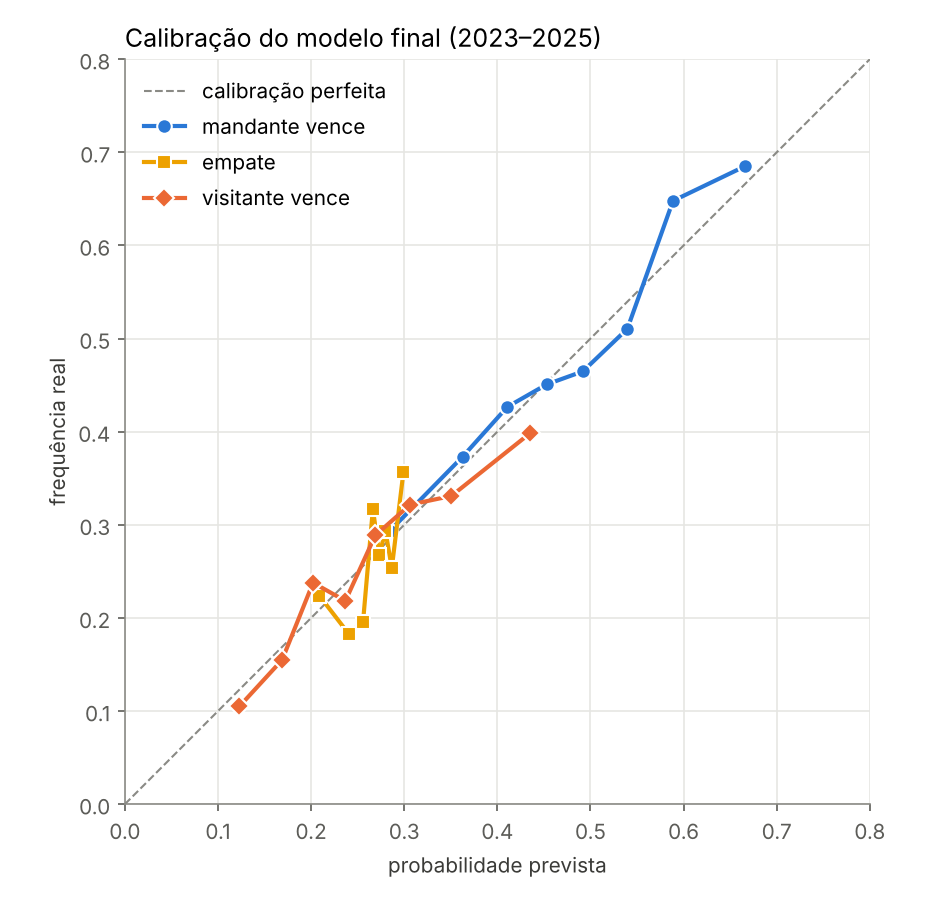
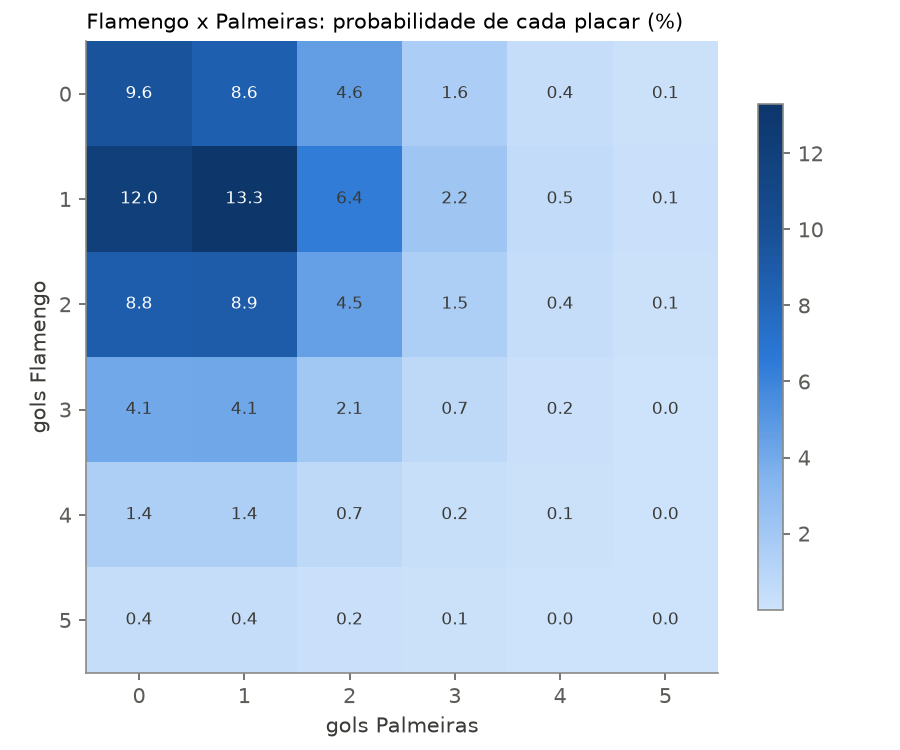

# ⚽ brasileirao-ml: previsão de jogos do Brasileirão

Modelos que dão a probabilidade de **vitória do mandante, empate e vitória do visitante** em jogos da Série A, avaliados com um backtest rodada a rodada em 1.140 jogos (2023–2025).

**Demo:** [Space no Hugging Face](https://huggingface.co/spaces/JulioBuzzi/previsao-brasileirao) · **Modelo:** [Hugging Face](https://huggingface.co/JulioBuzzi/previsao-brasileirao)



## Resultados

Backtest *walk-forward*: antes de cada rodada de 2023, 2024 e 2025, o modelo é retreinado só com os jogos já disputados e prevê os 10 jogos da rodada. Os hiperparâmetros e a escolha do modelo final foram decididos antes, numa validação com 2020–2022.

| Modelo | RPS ↓ | Log-loss ↓ | Brier ↓ | Acurácia |
|---|---|---|---|---|
| Baseline (frequência histórica) | 0,2206 | 1,0531 | 0,6346 | 48,2% |
| Elo + regressão logística | 0,2099 | 1,0211 | 0,6122 | 49,3% |
| Dixon-Coles (Poisson) | 0,2088 | 1,0165 | 0,6088 | 49,2% |
| Gradient Boosting (Elo + forma) | 0,2119 | 1,0306 | 0,6171 | 49,7% |
| **Média Dixon-Coles + Elo** | **0,2084** | **1,0160** | **0,6084** | **49,9%** |

- **O modelo final melhora o RPS em 5,5% sobre o baseline.** Num bootstrap por rodada, o ganho fica entre 0,0079 e 0,0166 (IC 95%), então não é sorte.
- **Os modelos clássicos de futebol (Dixon-Coles e Elo) ganharam do Gradient Boosting** com features de forma recente. Com 6 a 7 mil jogos de treino, um modelo com mais estrutura generaliza melhor.
- **As probabilidades são bem calibradas** (gráfico acima): quando o modelo diz 40%, aquilo acontece em ~40% das vezes.
- **O empate é o ponto fraco:** o modelo acerta a frequência média de empates (26,4% previsto contra 26,1% real), mas nunca coloca o empate como resultado mais provável. Por isso a acurácia fica perto de 50%, e as métricas que importam são RPS e log-loss.

**RPS** (*Ranked Probability Score*) é a métrica padrão pra previsão de futebol. Ela leva em conta a ordem dos resultados: errar "vitória" por "empate" é menos grave que errar por "derrota".

## Os modelos

| Modelo | Ideia |
|---|---|
| Baseline | Sempre a frequência histórica (~49% mandante / 27% empate / 24% visitante) |
| Elo + logística | Rating por time, atualizado a cada jogo (com mando e saldo de gols). Uma regressão logística transforma a diferença de Elo em 3 probabilidades |
| Dixon-Coles | Gols ~ Poisson(ataque × defesa adversária × mando), com correção pros placares baixos e jogos antigos pesando menos. Dá a probabilidade de cada placar |
| Gradient Boosting | Elo + pontos e gols nos últimos 5/10 jogos + desempenho em casa/fora + descanso + rodada |
| Média DC + Elo | Média das probabilidades do Dixon-Coles e do Elo (**modelo final**) |

## Notebooks

| Notebook | O que tem |
|---|---|
| [`01_dados.ipynb`](notebooks/01_dados.ipynb) | 23 temporadas (2003–2025), vantagem de jogar em casa por temporada, placares mais comuns |
| [`02_modelos.ipynb`](notebooks/02_modelos.ipynb) | Elo no fim de 2025, ataque/defesa no Dixon-Coles, matriz de placares de um jogo |
| [`03_backtest.ipynb`](notebooks/03_backtest.ipynb) | Backtest 2023–2025, comparação, bootstrap, calibração, empates |

<p float="left">
  
  
</p>

## Como rodar

```bash
git clone https://github.com/JulioBuzzi/brasileirao-ml.git
cd brasileirao-ml
python -m venv .venv && source .venv/bin/activate
pip install -r requirements.txt
jupyter notebook notebooks/          # os dados são baixados na primeira execução
python scripts/treinar.py            # treina o modelo final -> models/params.json e app/
python app/app.py                    # abre a demo em http://127.0.0.1:7860
```

```python
import sys; sys.path.insert(0, "src")
from brasileirao.predictor import Previsor

prev = Previsor.carregar("models/params.json")
prev.prever("Flamengo", "Palmeiras")
# {'mandante': 0.507, 'empate': 0.259, 'visitante': 0.234, 'gols_esperados': (1.51, 1.03), ...}
```

## Atualizando com 2026

Os dados públicos vão até 2025. Pra incluir 2026, salve os jogos em `data/raw/jogos_2026.csv` no formato de [`data/modelo_jogos_2026.csv`](data/modelo_jogos_2026.csv):

```
rodada,data,mandante,visitante,gols_mandante,gols_visitante
1,25/01/2026,Time A,Time B,2,1
```

Use os mesmos nomes de clube do modelo (a lista está em `times_ultima_temporada` no `models/params.json`). Nomes com acento comuns, como `São Paulo` e `Grêmio`, são convertidos automaticamente. Jogos ainda não disputados podem ficar com os gols vazios, porque eles são ignorados no treino. Depois rode `python scripts/treinar.py`.

## Estrutura

```
src/brasileirao/
  data.py        # download, padronização dos nomes dos clubes, temporadas
  features.py    # Elo e forma recente (calculados sem olhar o futuro)
  models.py      # Baseline, EloLogit, DixonColes, GradientBoosting, Media
  backtest.py    # walk-forward rodada a rodada + métricas (RPS, log-loss, Brier)
  predictor.py   # modelo final: treina, salva/carrega JSON, prevê confrontos
notebooks/       # 01, 02, 03
scripts/         # treinar.py
models/          # params.json + model card do Hugging Face
app/             # Space do Hugging Face (Gradio)
results/         # gráficos e previsões do backtest
```

## Dados

Jogos da Série A de 2003 a 2025 do [Brasileirao_Dataset](https://github.com/adaoduque/Brasileirao_Dataset), de Adão Duque. Eles são baixados direto da fonte (commit fixo) e não ficam neste repositório.

## Próximos passos

- Comparar com as odds das casas de aposta (o benchmark mais difícil)
- Usar estatísticas de jogo (chutes, chutes no alvo), disponíveis de 2015 a 2023 e em 2025
- Simular a tabela final (Monte Carlo) com as probabilidades de cada jogo

---

*Projeto de portfólio. Não é recomendação de aposta.*